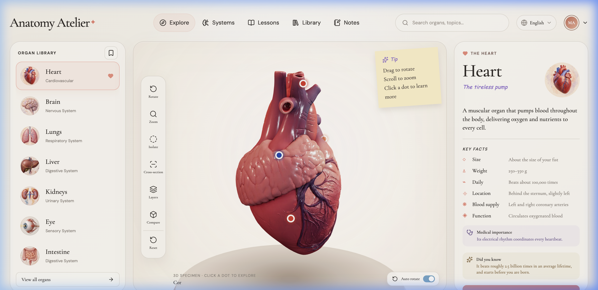

<div align="center">

# 🫀 Anatomy 3D

**An interactive, real-time 3D Human Anatomy Explorer built with Next.js, Three.js WebGL/TSL materials, and GSAP.**



<p align="center">
  <a href="https://github.com/authrain-cloud-abdullahformuli/anatomy/blob/main/LICENSE">
    
  </a>
  <a href="https://github.com/authrain-cloud-abdullahformuli/anatomy/actions">
    
  </a>
  <a href="https://threejs.org/">
    
  </a>
  <a href="https://nextjs.org/">
    
  </a>
  <a href="https://github.com/authrain-cloud-abdullahformuli/anatomy">
    
  </a>
</p>

Explore high-fidelity 3D human organ models with orbit controls, anatomical cross-sections, interactive annotations, and comparative pathology metrics in 12 languages.

</div>

---

## ✨ Features

- **Real-Time 3D WebGL Models**: Fully interactive 3D meshes for Heart, Lungs, Brain, Kidneys, Liver, Pancreas, Intestine, Eyeball, and Skin.
- **Three.js Shading Language (TSL)**: Subsurface scattering and biological tissue translucency shaders.
- **Interactive Anatomical Hotspots**: Clickable 3D marker pins with screen-space tracking for deep physiological insights.
- **High-Performance Geometry Pipeline**: Draco WASM geometry decompression and Basis Universal texture transcoding for instant load times.
- **Multilingual Support (12 Locales)**: Native translations for English, Spanish, German, French, Chinese, Japanese, Russian, Portuguese, Korean, Indonesian, Hindi, and Arabic (with RTL support).
- **Cinematic Camera Transitions**: Smooth orbital physics and focused zoom animations powered by GSAP.

---

## 🗂️ Organ Models Included

| Organ | 3D Mesh | Anatomical Highlights |
|---|---|---|
| **Heart** | `heart.glb` | Ventricles, atria, aorta, coronary arteries, rhythm cycles |
| **Brain** | `brain.glb` | Cerebral cortex, cerebellum, brainstem, lobes |
| **Lungs** | `lungs.glb` | Bronchial tree, lobes, pulmonary vessels |
| **Liver** | `liver.glb` | Hepatic lobes, gallbladder, portal vein |
| **Kidneys** | `kidneys.glb` | Renal cortex, medulla, pelvis, ureters |
| **Pancreas** | `pancreas.glb` | Head, body, tail, pancreatic duct |
| **Intestine** | `intestine.glb` | Small & large intestines, colon flexures |
| **Eyeball** | `eyeball.glb` | Cornea, iris, retina, optic nerve, lens |
| **Skin** | `skin.glb` | Epidermis, dermis, hypodermis, hair follicles |

---

## 🚀 Quick Start

### 1. Clone the repository

```bash
git clone https://github.com/authrain-cloud-abdullahformuli/anatomy.git
cd anatomy
```

### 2. Install dependencies

```bash
npm install
```

### 3. Run development server

```bash
npm run dev
# or
npm run build && npm run start
```

Open [http://localhost:3000](http://localhost:3000) in your browser.

---

## 🧪 Testing & Verification

Run the automated verification suite to validate all 3D assets, Draco decoders, and i18n dictionaries:

```bash
node test.mjs
```

---

## 📄 License

MIT © [Abdullah Formuli](https://github.com/authrain-cloud-abdullahformuli)
